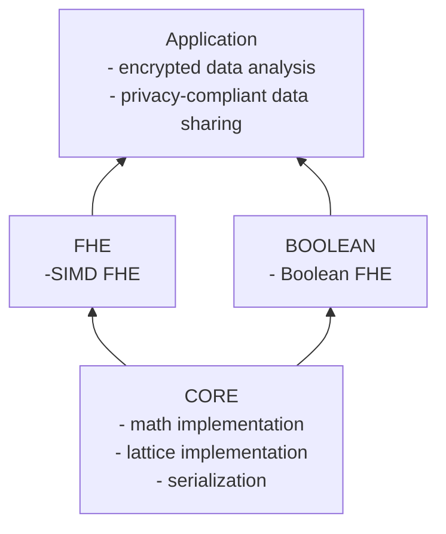

# Cipher Code Components

# boolean (`Cipher::boolean`)

- Boolean arithmetic, comparisons, and arbitrary function evaluation based on the DM, CGGI and LMKCDEY schemes
- Header: `cipher/boolean/context.h` (class `BooleanContext`)

# core (`Cipher::core`)

- underlying implementation (math, ring, util) providing the base that `boolean` and `fhe` are built on
- Header: `cipher/core.h`

# fhe (`Cipher::fhe`)

- integer and real-number arithmetic based on the BGV, BFV, and CKKS schemes
- Header: `cipher/cipher.h`

## Warning

Although Cipher provides various utility functions to make it accessible to
non-cryptographers, it is still necessary for the end-users to carefully consider how they are using the code. Improper
use can result in leaked information.
Use of Cipher in production environments should be reviewed by homomorphic encryption experts.

Additionally, see our [Security Considerations](../static_docs/Security.md) for considerations that should be taken into account
in your work.
