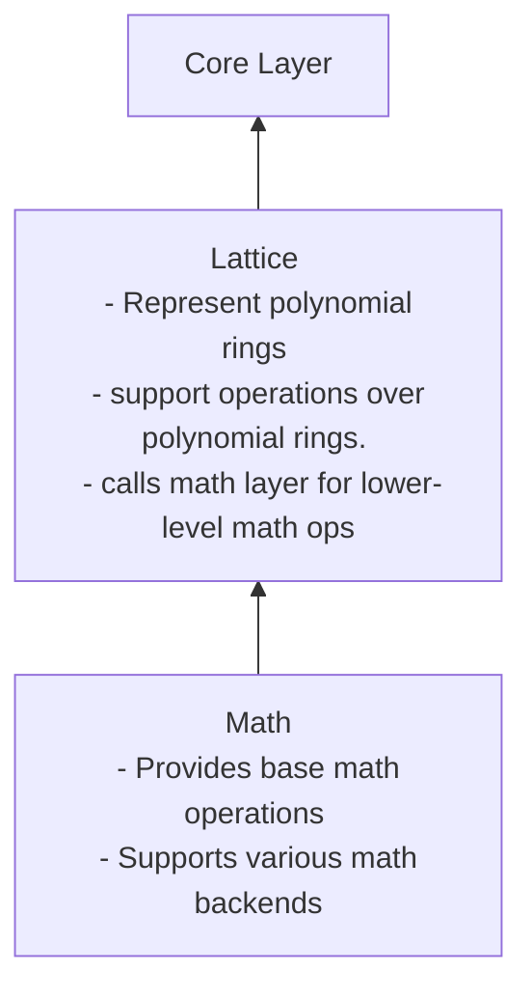

# Cipher Public Headers

The `math`, `ring` and `util` directories form the core library (`Cipher::core`, umbrella header `cipher/core.h`):
the underlying primitives that are used by both the [FHE schemes](fhe) (`Cipher::fhe`, `cipher/cipher.h`) and
[Boolean FHE](boolean) (`Cipher::boolean`, `cipher/boolean/context.h`). The implementation lives in `source/`,
mirroring this directory.

## [Ring](ring)

- Contains files that support lattice/polynomial-layer operations in Cipher. This layer is used to represent polynomial rings and support operations over those rings.

- As can be seen above, this is the "middle" layer between higher-level lattice cryptography elements, and the lower level math operations.

## [Math](math)

Contains various files describing the mathematical functionality supported in Cipher. For example:

- modular arithmetic
- sampling functions

In addition, the big-integer backends (the math hardware abstraction layer) are defined here, in [math/backend](math/backend).

## [Utils](util)

Contains various utilities:

- debugging utilities
- memory management utilities
- parallel operations
- serialization
