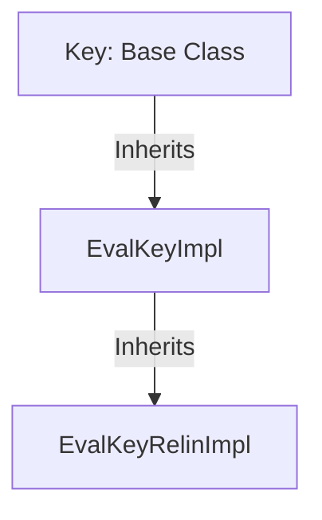
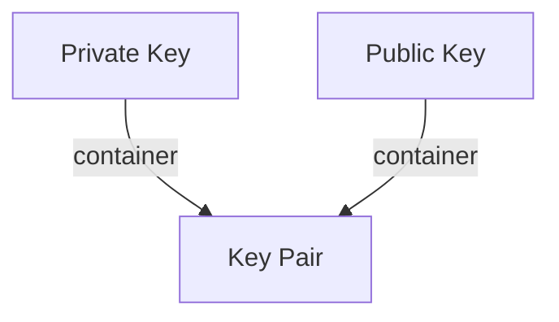

# Keys

This folder contains the header files of the various keys that are defined within `Open-FHE`. Refer to [OpenFHE PKE Keys](https://openfhe-development.readthedocs.io/en/latest/assets/sphinx_rsts/modules/pke/pke_keys.html)

## Key Class Inheritance

## KeyPair

[All Key](key.h)
- Top-level `#include` for access to all capabilities

[Eval Key](eval_key.h)
- Inherits from the base [Key](key.h) class.
- Serves as base class for [Eval Key Relin](relin_key.h)

[Eval Key Relin](relin_key.h)
- Get and set relinearization elements
- Inherits from [Eval Key](eval_key.h)

[Key](key.h)
- Base Key class

[Key Serialization](key_ser.h)
- Capabilities for serializing the keys using [Cereal](https://github.com/USCiLab/cereal)

[Key Pair](key_pair.h)
- Container for the [private key](private_key.h) and [public key](public_key.h)

[Private Key](private_key.h)

[Public Key](public_key.h)
