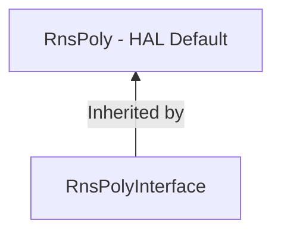

# Hardware Abstraction Layer (HAL)

This hardware abstraction layer allows Cipher to use a variety of device backends while still allowing for high performance. The tree currently ships the default backend in `standard/`.

## Note:

Follow the convention set by the `standard/` implementation (selected in `backend_select.h`) to extend the supported backends.
